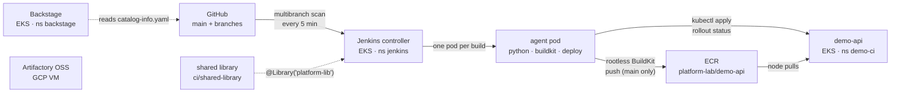

# CI track: Jenkins → ECR → EKS, with a portal and an artifact store

A practice environment for a mid-level DevOps role built around Jenkins
pipelines, reusable pipeline code, AWS, EKS and Docker. Everything here was
built and run on a live playground; the failures in
[drill 18](../drills/18-jenkins-pipeline-failures.md) are real output.

## What runs where



| Piece | Where | Why there |
|---|---|---|
| Jenkins | EKS, `jenkins` ns | agents are pods: a build gets a clean container set and disappears |
| demo-api | EKS, `demo-ci` ns | the deploy target; agent RBAC is limited to this namespace |
| Backstage | EKS, `backstage` ns | catalog of what exists and who owns it |
| Artifactory OSS | **GCP playground**, e2-standard-2 VM (`terraform/gcp-artifactory`) | doesn't fit AWS: the ECS cap is 2048 CPU / 4096 MB (a 2 vCPU / 8 GB attempt earned a fair-use violation), and t3.medium nodes OOMKilled it. GCP allows 7 vCPU, so it runs there, verified: admin/admin, `generic-local` repo, upload and download. Jenkins reaches it over the internet like any SaaS registry. URL: `./scripts/gcp-urls.sh` |
| Datadog | not installed | SaaS: the trial needs a business email, which we did not have. Installer is ready (`DD_API_KEY=... make datadog`, sized for the playground caps). Study it through the mapping in "Datadog without an account" below |

URLs change every rebuild. Get them with `make urls` (EKS NodePorts: Jenkins
30094, demo-api 30095, Backstage 30096, Artifactory 30097).

## Build it

```bash
NODE_DESIRED=5 ./scripts/eks-up.sh               # ~20 min
make jenkins                                     # prints URL + admin password
make backstage
```

Then open Jenkins → `demo-api` → **Scan Multibranch Pipeline Now**.

## Read the code in this order

1. [`ci/apps/demo-api/Jenkinsfile`](../ci/apps/demo-api/Jenkinsfile) has four
   lines. Everything else is in the library. That is the whole point of a shared
   library: 50 teams, one place to fix the pipeline.
2. [`vars/standardPipeline.groovy`](../ci/shared-library/vars/standardPipeline.groovy):
   the declarative pipeline. Stages, `when { branch 'main' }`, `post`.
3. [`vars/buildImage.groovy`](../ci/shared-library/vars/buildImage.groovy): ECR
   login with no stored credentials, rootless BuildKit, and the two bugs from
   drill 18 in its comments.
4. [`vars/deployToEks.groovy`](../ci/shared-library/vars/deployToEks.groovy):
   why `rollout status` matters more than `apply`.
5. [`ci/jenkins/values.yaml`](../ci/jenkins/values.yaml): JCasC. The library,
   the job and the agent templates are all config, not clicks.
6. [`catalog-info.yaml`](../catalog-info.yaml): what Backstage shows.

## Things to practise until they are boring

- Create a branch, change a test so it fails, push. Watch the branch build run
  Test and **skip** push and deploy. Then fix it.
- Change the `/` response, merge to main, watch it deploy. `curl` it.
- Every scenario in drill 18. Break it, read the error, *then* look at the fix.
- `kubectl auth can-i ... --as system:serviceaccount:jenkins:jenkins-agent`
- Delete the Jenkins controller pod. It comes back with the same job and library,
  because both come from JCasC and the PVC.
- Add a component to `catalog-info.yaml`, push, and wait for Backstage to pick
  it up (it re-reads locations on a schedule).

## Questions you will get, and the answer that sounds mid-level

**"How do you share pipeline code across teams?"** A global shared library,
loaded by name and pinned to a version: `vars/` for steps, `src/` for classes,
`resources/` for files such as pod templates. Teams get a 4-line Jenkinsfile.
Libraries configured by an admin are *trusted* and run outside the Groovy
sandbox, which is why logic belongs there and not in Jenkinsfiles. Pin teams to
a tag, because a bad commit to the library's `main` breaks every pipeline at once.

**"Declarative or scripted?"** Declarative for pipelines, because it is
structured, validated and readable, with `script {}` blocks or library steps
where real logic is needed. Scripted is Groovy all the way down, which is
flexible and harder to review.

**"How do you build images inside Kubernetes?"**
- `docker.sock` mount: impossible on EKS ≥ 1.24 (no Docker on nodes), and root
  on the node anyway.
- DinD: works, needs `privileged: true`.
- kaniko: archived by Google in June 2025. Know it, but don't propose it.
- **Rootless BuildKit**: what this lab uses. No privileged container. It needs
  seccomp/AppArmor `Unconfined` and `--oci-worker-no-process-sandbox`, which is a
  trade worth being able to state.

**"How does the pipeline authenticate to ECR?"** With no stored secret. The
agent mints a 12-hour token from an IAM role. Here that is the node role, which
means *every* pod on the node can push. The production answer is **IRSA / EKS
Pod Identity**: the role is bound to the agent's service account only.

**"A deploy failed. What do you do?"** Find the first red stage, not the last
line. Decide which layer produced the message (Jenkins, registry, IAM, the
Kubernetes API, kubelet or the app), then check it from that layer's own tool:
`aws sts get-caller-identity`, `kubectl auth can-i`, `kubectl describe pod`,
`kubectl get events`. Drill 18 is six worked examples.

**"Why ECS for one thing and EKS for another?"** Pick the smallest platform
that fits. A single stateful vendor container with no scaling story does not
need Kubernetes: on ECS Fargate it is a task definition and a service
(`terraform/ecs`). Two costs showed up here. First, **no log driver without an
execution role**, so the app died inside a container that stayed RUNNING and
nothing said so. Running the same image as a pod on EKS and reading `kubectl
logs` found three separate start-up failures in turn. Second, **platform
limits enforced after the fact**: the playground's compliance job deleted the 2 vCPU / 8 GB
service minutes after a successful apply. CloudTrail (`lookup-events`) showed
who did it. Both are good answers to "tell me about a time something failed
silently".

**"What is Backstage for?"** So that other teams can answer *who owns this,
where is its pipeline, how do I start a new one* without asking the platform
team. It has a catalog (from `catalog-info.yaml` in each repo), software
templates and TechDocs. Plugins are compiled in, so you build your own image.
That is the main operational difference from Jenkins.

**"What would you watch in Datadog for this?"** Agent DaemonSet plus cluster
agent, with consistent `env`/`service`/`team` tags (untagged data cannot be
queried), and monitors on deployment replicas-unavailable, pod restarts, and
build failure rate. The trap on EKS is that the kubelet cert is not valid for
the address the agent dials, so with TLS verification on you get **no pod
metrics and no error in the UI**. See `ci/datadog/values.yaml`.

### Backstage: who adds what

Backstage doesn't deploy anything or install CRDs. It's a portal that
**reads**: from git (the catalog) and from Kubernetes (the Kubernetes tab).
The work divides like this:

| Who | Adds | In this repo |
|---|---|---|
| **Developer** | their service's `catalog-info.yaml`: description, owner, the API it provides | `templates/new-service/skeleton/catalog-info.yaml` |
| **Platform / DevOps** | org and ownership (Groups) | `catalog/org.yaml` |
| **Platform / DevOps** | systems, domains, infrastructure Resources, `dependsOn` edges | `catalog/systems.yaml`, `catalog/resources.yaml`, `catalog/components.yaml` |
| **Platform / DevOps** | **the golden-path template**: "new service" generates the pipeline, Dockerfile, manifests and catalog entry | `templates/new-service/` |
| **Platform / DevOps** | **the Kubernetes tab**: a read-only ClusterRole, cluster config, pod labels, and which **CRDs** to show (Argo Rollouts) | `ci/backstage/rbac.yaml`, `kubernetes:` in `ci/backstage/values.yaml`, `backstage.io/kubernetes-id` label in demo-api's Deployment |
| **Platform / DevOps** | running Backstage: custom image (plugins are compiled in), PostgreSQL, TLS, auth | `ci/backstage/values.yaml` comments |

**Exercises:**
1. **Catalog graph:** open demo-api → *Dependencies*. Follow it to
   platform-lib, Jenkins, the EKS cluster and the Terraform state bucket. That's
   "what breaks if X goes down", answered from git.
2. **APIs:** open the demo-api API. The OpenAPI spec is read from
   `ci/apps/demo-api/openapi.yaml`, next to the code, so it can't drift silently.
3. **Create → New Python service:** fill the form and look at the generated
   files. The publish step is commented out because it needs a GitHub token;
   say that in the interview, it shows you know how the last step works.
4. **Add a component:** add one to `catalog/components.yaml`, push, wait
   for the refresh, and find it. No clicking "register".
5. **Kubernetes tab** (*not yet verified live*): open demo-api → *Kubernetes*.
   Its pods appear because they carry `backstage.io/kubernetes-id: demo-api`.
   Break a deploy (drill 18 §4) and watch the unready pod show up here.

### Datadog without an account

Interviewers asking about a "nice to have" tool ask about concepts, not
clicks. Each Datadog concept has a counterpart already run in this lab:

| Datadog | What it is | The equivalent you have touched |
|---|---|---|
| **Node Agent** (DaemonSet) | one collector per node: host, container and kubelet metrics, logs, traces | Prometheus scraping each node; one DaemonSet pod per node, like `aws-node` |
| **Cluster Agent** (Deployment) | one per cluster: talks to the API server so every node agent doesn't, and feeds cluster-level checks | kube-state-metrics: object state (replicas, restarts) rather than node stats |
| **Tags** `env`, `service`, `version`, `team` | how every metric, log and trace is sliced. Unified Service Tagging ties all three to one service | Kubernetes labels and Prometheus labels. Untagged data is as useless as an unlabelled metric |
| **Monitors** | alert definitions: threshold, anomaly, composite | Prometheus alert rules; Flagger's analysis queries in the GitOps track |
| **APM / traces** | request flow across services; the `ddtrace` library or OpenTelemetry | OpenTelemetry. Datadog ingests OTLP, so OTel instrumentation carries over |
| **Logs + pipelines** | container stdout shipped by the agent, parsed by pipelines, retention by index | `kubectl logs`, the same stdout. Logging to stdout is what makes either work |
| **Dashboards / SLOs** | graphs, plus error-budget tracking | Grafana dashboards; `rollout status` as a deploy-time health gate |
| **API key vs Application key** | the API key *sends* data (agents); the App key *reads/configures* via the API | Like ECR push rights vs read-only: separate the writer from the reader |

**Monitors worth naming for this pipeline:** deployment replicas unavailable >
0 for 5 min (drill 18 §4 is exactly this), pod restarts climbing, image pull
errors (§5), Jenkins build failure rate on `main`, and node CPU steal on
burstable instances (drill 17).

**Pitfalls worth knowing**, both already written into `ci/datadog/values.yaml`:
- on EKS the kubelet's certificate isn't valid for the address the agent dials.
  With TLS verification on you get **no pod metrics and no error in the UI**.
  `kubelet.tlsVerify: false` is the documented workaround.
- `DD_SITE` must match the account's region (`datadoghq.eu` vs `datadoghq.com`).
  If it's wrong, every submission is rejected and the agent calls a good key
  invalid.

**Say this:** "I prepared the Helm install and sized it for our cluster's
quota, but didn't get trial access. Here's how I'd tag it, which monitors I'd
start with, and the EKS kubelet gotcha I'd check first."

**"How do you make Terraform reviewable and safe?"** Plan in CI on the PR and
post the plan, with apply only from main. Use remote state with locking (S3
native locking here), pinned providers, and no secrets in variables. When a
resource already exists, `import` it instead of recreating it. That happened
here with the ECS cluster.
